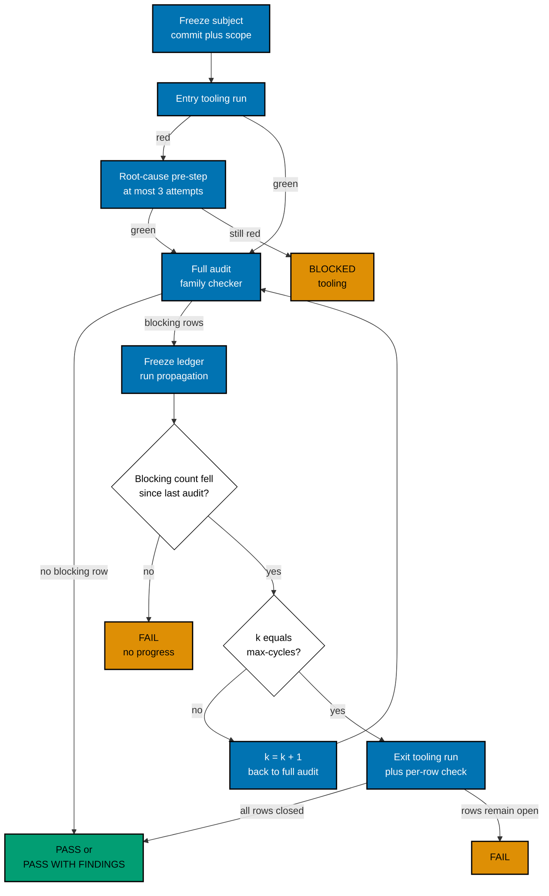

# Sequence and Termination

## Sequence

One cycle is one full audit followed by one repair. Every arrow back to an earlier step is bounded by the cycle counter
`k`.

1. **Freeze the subject.** Record the commit and the exact scope. A subject changed during the run by anything other
   than this run's own writer ends it `BLOCKED` (input-changed), and the ledger is kept.
2. **Run the entry check.** Green continues. Red starts the root-cause pre-step in
   [Inputs, Scoring, and the Deterministic Boundary](001-inputs-scoring-and-boundary.md).
3. **Audit.** The checker audits the whole frozen scope in its current state, rates each finding's criticality, and
   reports nothing the Deterministic Boundary table excludes.
4. **Classify.** Each row is blocking or not under the mode threshold.
5. **Terminate early** when no blocking row is open: `PASS` if the ledger holds no open row at all, otherwise
   `PASS_WITH_FINDINGS`.
6. **Hand off.** Freeze the open blocking rows as ledger `L_k` and run `<family>-propagation`. It re-validates and rates
   each row, repairs only rows of `L_k`, verifies each, and records its status with evidence, per
   [Sole-Writer Propagation](../sole-writer-propagation.md).
7. **Require progress.** From the second audit on, the open blocking count must be strictly lower than at the previous
   audit. Otherwise the run ends `FAIL` (no progress).
8. **Stop at the ceiling.** When `k` equals `max-cycles`, no further audit runs; a fourth audit is never reached. The
   exit check runs once. The writer reverts a repair that turned it red and marks that row `not-resolved`. The run ends
   `PASS` or `PASS_WITH_FINDINGS` when every blocking row is `resolved` with evidence and the exit check is green, and
   `FAIL` otherwise.

At the ceiling, verified repairs stay. Nothing asks a person mid-run whether to continue, and nothing adds a cycle.

## Termination

| Condition                                                              | Verdict                        |
| ---------------------------------------------------------------------- | ------------------------------ |
| An audit has no open row                                               | `PASS`                         |
| An audit has open rows but none blocking                               | `PASS_WITH_FINDINGS`           |
| After the final repair: every blocking row resolved, exit run green    | `PASS` or `PASS_WITH_FINDINGS` |
| Blocking rows remain at the ceiling, or a `needs-decision` row is open | `FAIL`                         |
| The open blocking count did not fall between two audits                | `FAIL`                         |
| Entry tooling still red after 3 root-cause attempts                    | `BLOCKED` (tooling)            |
| The subject changed during the run                                     | `BLOCKED` (input-changed)      |
| The checker or the propagation could not run                           | `BLOCKED` (unavailable)        |
| `max-cycles` is outside 1–3, or `subject` is missing                   | Refuses to start               |

Every run reaches exactly one row of this table. A gate file copies the table unchanged into its `## Termination`
section or links it, and adds no row of its own.
